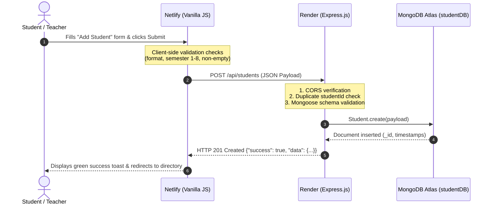

# System Architecture: Student Information Management System (SIMS)

## 1. Overview
The **Student Information Management System (SIMS)** is engineered following the industry-standard **Three-Tier Architecture pattern**. Each tier is completely decoupled, deployed on independent cloud infrastructure, and communicates strictly through secure, standardized protocols.

```mermaid
graph TD
    subgraph Client ["Client Layer"]
        Browser["User Web Browser"]
    end

    subgraph Tier1 ["Tier 1: Presentation Tier (Netlify)"]
        HTML["HTML5 UI / Forms"]
        CSS["CSS3 Responsive Styles"]
        JS["Vanilla JavaScript Client (Fetch API)"]
    end

    subgraph Tier2 ["Tier 2: Application Tier (Render Web Service)"]
        Express["Express.js Server"]
        Router["REST API Router (/api/students)"]
        Controller["Student Controller (Business Logic)"]
        Middleware["CORS & Error Handlers"]
        Model["Mongoose ODM (Schema & Validation)"]
    end

    subgraph Tier3 ["Tier 3: Database Tier (MongoDB Atlas)"]
        AtlasCluster["Atlas Cloud Cluster"]
        DB["Database: studentDB"]
        Coll["Collection: students"]
    end

    subgraph DevTool ["Developer Environment (Antigravity IDE)"]
        MCP["MongoDB MCP Server (Read-Only)"]
    end

    Browser <--> |HTTPS| Tier1
    JS <--> |HTTPS REST API / JSON| Express
    Express --> Router --> Controller --> Model
    Model <--> |Mongoose TLS / TCP Driver| AtlasCluster
    AtlasCluster --> DB --> Coll
    MCP -.-> |Direct TLS Inspection (Dev Only)| AtlasCluster
```

---

## 2. Detailed Tier Specifications

### Tier 1 — Presentation Tier (Frontend)
* **Hosting Platform:** [Netlify](https://www.netlify.com/) (High-performance global CDN edge network)
* **Technologies:** HTML5, CSS3, Vanilla JavaScript (ES6+)
* **Communication:** Makes asynchronous `fetch()` HTTP requests to the Render backend.
* **Responsibilities:**
  - Rendering responsive dashboard, directory tables, and input forms.
  - Client-side input validation and error feedback.
  - Asynchronous state management (loading spinners, empty states, error toasts).
* **Security Isolation:** **Zero access to database credentials**. The frontend communicates exclusively with the Express REST API endpoints.

---

### Tier 2 — Application Tier (Backend)
* **Hosting Platform:** [Render](https://render.com/) (Managed Linux Web Service)
* **Technologies:** Node.js (v24 LTS), Express.js framework
* **Communication:** Receives HTTPS REST requests from Netlify; communicates with MongoDB Atlas via the Mongoose driver over an encrypted TLS connection.
* **Responsibilities:**
  - Exposing REST API endpoints (`/api/health`, `/api/students`).
  - Request body parsing with strict 100kb payload size limits.
  - CORS security enforcement (permitting only the Netlify frontend origin).
  - Data validation, duplicate checking (HTTP 409 Conflict), and centralized error handling.
  - Safe logging without exposing secrets or credentials.

---

### Tier 3 — Database Tier (Cloud Persistence)
* **Hosting Platform:** [MongoDB Atlas](https://www.mongodb.com/atlas) (Managed Cloud NoSQL Cluster)
* **Database Name:** `studentDB`
* **Collection Name:** `students`
* **Responsibilities:**
  - Persistent storage of student documents.
  - Enforcing schema rules and unique constraints on `studentId`.
  - Maintaining text indexes for sub-millisecond search queries.
  - Role-Based Access Control (RBAC) database user permissions and IP whitelist enforcement.

---

## 3. End-to-End Request & Response Flow



---

## 4. MCP Server Role in Architecture

Examiners frequently ask: *"Is MCP part of the application runtime?"*

> **Answer:** **No.** The **Model Context Protocol (MCP)** server (`mongodb-mcp-server`) runs strictly inside the developer's Antigravity IDE environment.
> - **During Development:** MCP gives the AI coding agent read-only access to inspect the Atlas database schema, collection indices, and live statistics.
> - **In Production:** The deployed web application running on Netlify and Render does **NOT** use or require MCP. The application interacts with MongoDB Atlas strictly via the Mongoose connection in the Express backend.
